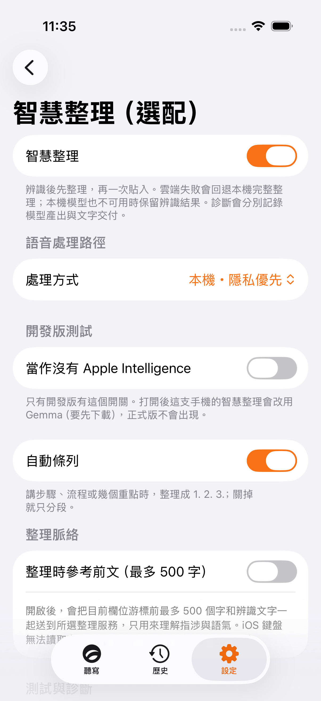
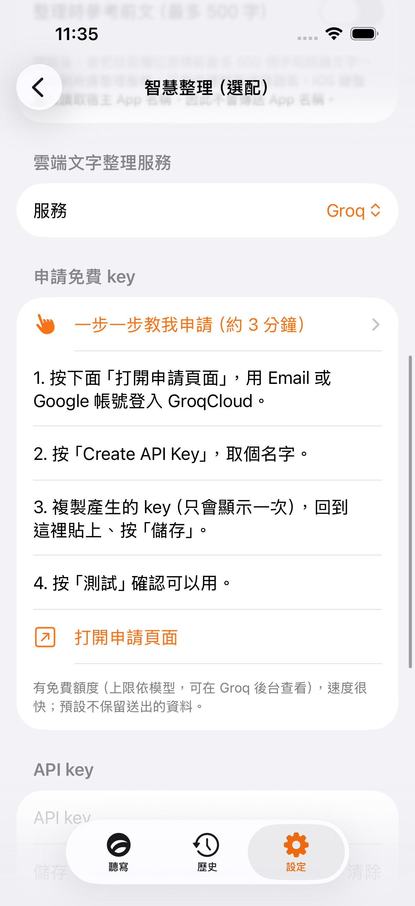

# iOS dictation routing

## Two processing modes

| Mode | Keyboard recognition | Text polishing | Failure |
| --- | --- | --- | --- |
| Local | Apple Speech, with on-device recognition required | Apple Intelligence; prepared Gemma on devices without it | Preserve transcript, record `raw-fallback`; never upload |
| Cloud | Explicitly selected ASR provider; private Apple transcript in parallel when available | Explicitly selected text provider | ASR failure uses the private transcript and local polish; polish failure gets a separate bounded local attempt |

The keyboard's containing app stays in its existing background audio session. It never invokes MLX Qwen, whose implementation requires the foreground/GPU. Qwen remains an optional enhancement for foreground dictation inside the app, in local mode only. This does not claim that removing a foreground check makes Qwen background-safe.

Cloud keyboard recognition can operate without an available Apple recognizer. In that case there is no offline ASR fallback: cloud failure is an explicit failure, not an empty successful insertion. Apple's final-result timeout still completes cloud ASR instead of skipping it.

No silent switching among unrelated saved provider keys. Audio and text provider selections are independent and pinned. Existing text-only BYOK users retain their cloud polishing without newly authorizing audio uploads; their settings show a one-time enable action for cloud recognition. Selecting cloud mode explicitly authorizes that route. Legacy local-only settings migrate to local mode.

The processing mode, audio authorization and text preferences live in the App Group. Text preferences migrate from the containing app's old defaults without overwriting an existing shared choice.

## Recognition → polish → insertion

1. Display partial recognition in the keyboard preview only.
2. Finish recognition, preserving a private fallback transcript when available.
3. Polish the raw transcript with bounded field context and relevant vocabulary.
4. Validate the candidate using the same rules for every provider.
5. Publish one final result, with the original ASR transcript separately retained.
6. Insert only into the same field. Record delivery only after insertion; save the final output and original transcript to history once.

While polishing, pressing the microphone does not flush raw text and silently abandon polish. Cancel/session replacement invalidates the task owner. Rewrite/ask instructions bypass dictation polishing. The foreground app likewise commits and writes history after polish, and changing tabs does not create a duplicate raw history entry.

## Validation and vocabulary

`DictationPolish` permits explicit numeric self-corrections and close Latin spellings of supplied vocabulary before applying the existing content-preserving validator. No provider receives a broad overlap-based exemption. Changed numeric values, added/removed negation, unrelated answers and unrequested rewriting remain rejected. This is a conservative lexical check, not proof of semantic equivalence; arbitrary long-distance paraphrases may still fall back.

Personal terms are ranked by this utterance's exact/fuzzy relevance with deterministic ties before truncation. Relevant professional terms receive space within the local model's 40-term window even with hundreds of personal terms. The cloud cap stays at 200 terms. The foreground normalizer reads a fresh dictionary per operation.

Cloud polish has the existing length-based 4–10 second bound. A failed cloud attempt does not exhaust local polish's separate budget (8 seconds for Apple Intelligence; existing length-scaled Gemma budget). If both fail, the transcript is retained. Disabling polish runs neither model.

## Diagnostics

- `candidate` / `local:candidate`: model output accepted, not yet delivered.
- `http(...)`, `timeout`, `rejected`, `local:...`: stage failure.
- `raw-fallback`: no usable polish, retained recognition.
- `delivered`: keyboard/app inserted its final result.
- `delivery-skipped-field-changed`: insertion withheld because the target changed.

Keyboard polish/delivery entries share a command `traceID`. Logs contain time, provider, stage, lengths and outcome, not transcript contents or credentials. ASR keeps its existing separate diagnostics.

## Reference and platform boundary

Reviewed OpenTypeless commit `f5ad602`:
https://github.com/tover0314-w/opentypeless/blob/f5ad602/src-tauri/src/pipeline.rs

Its separation of STT finalization, polish/output and final history/diagnostics informed this design. No Rust code was copied. Desktop accessibility, active-app detection and streaming insertion are not ported to the iOS keyboard. iOS context remains opt-in surrounding text and field hints; no host app name is fabricated.

## Verification

Core regressions: `Tests/UTUVOTypeCoreTests/DictationPolishTests.swift`.
iOS regressions: `CleanupLatencyTests`, `RecognitionRouteTests`, `SmartCleanupTests`, `VocabularyCatalogTests`, plus existing bridge, history, keychain and localization tests.

Use the `UTUVOTypeiOSTests` target (not the directory name `iOSTests`). Simulator tests need ad-hoc signing to exercise App Group keychain access. MLX's existing build dependency also needs Xcode's Metal Toolchain.

Real-device acceptance still requires a signed iPhone build: use Groq while the host app is backgrounded in another app's text field; repeat in airplane mode; cancel while polishing; switch fields before completion; verify final history and diagnostic trace IDs. Mock transport tests do not establish real Groq latency or Foundation Models availability on a particular phone.

### Observed checks (2026-10-22)

- `swift build`: passed.
- Core validation, vocabulary and presentation regressions: 9 passed.
- Final combined affected iOS suite: 220 passed, 0 failures (including routing, presentation, bridge, keychain, and localization).
- Mode-switching UI test: passed; inspected exported local/cloud screenshots.
- Earlier full Swift run: core 300 tests, 1 existing skip, 1 failure in `ZhuyinTests.testFootprintInstrumentSeesAWholeFileRead` (footprint delta reported zero); that test passed when run alone. macOS app 139 tests, 2 existing skips, 0 failures.
- Earlier full ad-hoc-signed iOS run: 542 tests, 12 existing skips, one failing test (`TipJarTests.testSuccessfulTipThanksAndFinishesTransaction`, three assertions). Xcode's local StoreKit server canceled the purchase. No tests were disabled and the purchase implementation was not changed.
- Android `./gradlew :core:test`: blocked before tests; installed JVM is 16, while Gradle requires JVM 17 or later.
- Secret scanner and hygiene tests: passed.
- `git diff --check`: passed. No real provider API requests or on-device microphone acceptance test were performed.

## Final text presentation

The selected language/variant travels with the completed keyboard command; changing the next utterance's language cannot reinterpret a pending result. Both keyboard delivery and foreground dictation use `TextPipeline` with that snapshot.

For `zh-TW`, final processing uses the bundled TraditionalFixer and TaiwanPhrases (e.g. 软件/軟件 → 軟體, 数据库/數據庫 → 資料庫). HK/CN/English variants do not inherit those Taiwan transforms. The speech analyzer's preliminary conversion follows the same variant rule.

`TextPresentation` protects dictionary source/target spellings, vocabulary-only entries, HTTP(S) URLs, email addresses and backtick-delimited code from the intervening transforms. It then inserts one space at Han/Latin-or-number boundaries, preserving Latin tokens (`iOS26`, `ChatGPT`), line breaks and literal-internal spacing. Explicit dictionary spellings override regional conventions, including 臺/台, capitalization and numeric-looking names. Dictionary substitution is a longest-match, single-pass operation within each formatting pass, not sequential cascading replacement.

The cleanup validator compares source/candidate under the same regional and explicit dictionary rules. This permits authorized changes such as 軟件 → 軟體 or a named dictionary replacement without weakening the numeric/negation gate for unrelated content.

## Simulator screenshots

Captured from the passing `TutorialUITests.testDictationModesShowOnlyRelevantSettings` test on iPhone 17 Pro / iOS 26.2. These show the real Debug UI, not a mockup or evidence of live cloud/voice latency. Local mode hides cloud configuration; the cloud screenshot is scrolled to the provider setup.

| Local mode | Cloud provider configuration |
| --- | --- |
|  |  |
